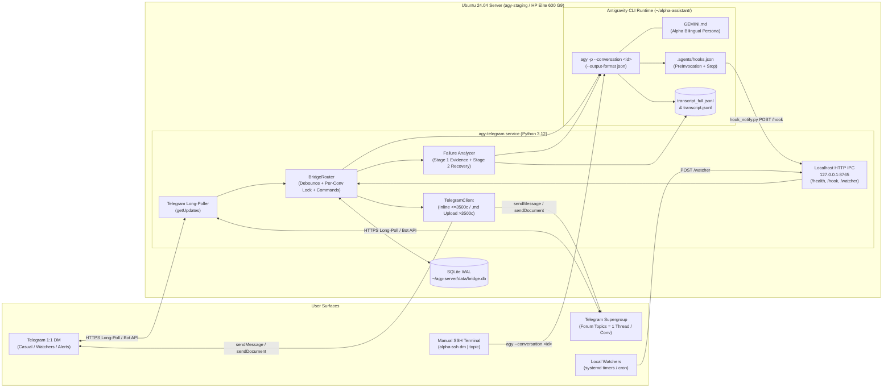

# Alpha 24/7 Home AI Server — Architecture & Design Document

> **Status:** v1 Implemented & Verified on Staging VM (`agy-staging`)  
> **Repository:** `agy-home-server`  
> **Last Updated:** 2026-11-25

---

## 1. Goals & Design Principles

Build a reliable, 24/7 personal home AI server powered by Antigravity CLI (`agy`) with a dedicated **Alpha** persona, staged first on a disposable VirtualBox Ubuntu 24.04 VM (`agy-staging`) and designed for lift-and-shift deployment to physical hardware (**HP Elite 600 G9 Mini PC**: i5-12500T, 24 GB RAM, 256 GB NVMe, Intel vPro/AMT).

Core principles:
- **Thin, channel-agnostic bridge:** Separate channel adapters (Telegram today; Gmail and local watchers next) from SQLite conversation routing and `agy` execution.
- **Zero-dependency runtime:** Bridge runs purely on Python 3.12 stdlib + SQLite (WAL) — no heavy runtime daemon, fast startup, low memory footprint (~25 MB for the bridge, ~300 MB total idle VM RAM).
- **Native Antigravity customization:** Persona (`GEMINI.md`), SSH synchronization (`hooks.json`), and workspace automation (`.agents/skills/staging-vm/`) use Antigravity's built-in primitives rather than external wrapper frameworks.
- **Transcript as source of truth:** All turns (Telegram, SSH, or proactive watchers) flow into `agy`'s persistent `transcript.jsonl` / `transcript_full.jsonl`, enabling deterministic deduplication, SSH-to-Telegram mirroring, and structured failure recovery.
- **Fail-closed security:** Strict user allowlisting, `0600` secret files excluded from git, loopback-only IPC (`127.0.0.1`), and passwordless SSH key auth.

---

## 2. High-Level System Architecture



---

## 3. Two-Instance Workspace Layout

To keep personal Alpha interactions completely isolated from plain engineering/admin work:

```text
/home/agy/
├── alpha-assistant/                 # Dedicated Alpha workspace (CWD for bridge & alpha-ssh)
│   ├── GEMINI.md                    # Alpha persona (PRISM accuracy rules, ZH/EN mirroring)
│   ├── .agents/
│   │   └── hooks.json               # PreInvocation + Stop hooks -> hook_notify.py
│   ├── memory/                      # (Reserved) USER.md / MEMORY.md / STATE.md
│   └── inbox/                       # (Reserved) Staged multimodal attachments per conv_id
├── agy-server/                      # Deployed bridge code + runtime state
│   ├── .env                         # 0600 secrets (TELEGRAM_BOT_TOKEN, ALLOWED_USER_IDS)
│   ├── data/bridge.db               # SQLite WAL database
│   ├── server/                      # Python bridge package
│   ├── systemd/                     # Unit file template
│   └── tests/                       # Unit & integration tests
└── .gemini/antigravity-cli/
    ├── antigravity-oauth-token      # 0600 persisted Google OAuth refresh token (survives reboot)
    ├── settings.json                # CLI permission & workspace settings
    └── brain/<conv_id>/.system_generated/logs/
        ├── transcript.jsonl         # Compact trajectory log
        └── transcript_full.jsonl    # Full untruncated trajectory log (preferred by bridge)
```

---

## 4. Conversation Routing & Database Schema

### 4.1 Mapping Patterns
| Usage Pattern | Telegram Identifier | Normalized Key (`bindings`) | Behavior |
| --- | --- | --- | --- |
| **1:1 DM** | `chat_type="private"`, `chat_id=<user_id>` | `("telegram", chat_id, thread_id=0)` | Single persistent Alpha conversation; also default target for `/watcher` alerts. |
| **Supergroup Forum Topic** | `chat_type="supergroup"`, `message_thread_id=N` | `("telegram", chat_id, thread_id=N)` | Lazily creates an independent `agy` conversation on first message; captures topic name from `forum_topic_created`. |
| **Supergroup General Topic** | `message_thread_id` omitted or `1` | `("telegram", chat_id, thread_id=1)` | Outgoing Bot API calls omit `message_thread_id` when `thread_id <= 1`. |

### 4.2 SQLite Schema (`server/db.py`, WAL mode)
- **`bindings`**:
  - `id`, `channel`, `chat_id`, `thread_id`, `chat_type`, `topic_name`
  - `agy_conversation_id` (populated on first `agy -p` turn)
  - `workspace_dir` (defaults to `/home/agy/alpha-assistant`)
  - `mirror_mode` (`full` | `replies_only` | `muted`, default `full`)
  - `last_mirrored_step` (monotonic watermark against `transcript.jsonl` `step_index`)
  - `active` (`1` = current binding; `0` = archived via `/reset`, preserving old transcripts on disk)
  - Partial unique index on `(channel, chat_id, thread_id) WHERE active = 1`
- **`message_log`**: Audit trail of `in`, `out`, and `mirror` turns with `origin`, `external_message_id`, `agy_step_index`, `content_preview`, and `attachments_json`.
- **`kv_state`**: Persists `telegram_offset` across restarts so updates are neither replayed nor dropped.

---

## 5. Turn Lifecycle & Concurrency Flows

### 5.1 Telegram Inbound Turn (`server/router.py`)
1. **Authorization:** Checks `TELEGRAM_ALLOWED_USER_IDS` (and optional `TELEGRAM_ALLOWED_CHAT_IDS`). Fails closed when unconfigured while logging unauthorized `(user_id, chat_id, thread_id)`.
2. **Control Commands:** `/status`, `/mirror`, `/reset`, `/compact`, `/id`, `/help` are intercepted immediately by the bridge (zero LLM latency/quota).
3. **Debounce Coalescing:** Normal text messages wait `DEBOUNCE_SECONDS` (`1.5s`) per `(channel, chat_id, thread_id)` so rapid multi-bubble texts merge into one turn.
4. **Per-Binding Lock + SSH Collision Guard:** Acquires a per-binding `threading.Lock`. If `PreInvocation` marked the `agy_conversation_id` busy from an active SSH session, notifies the user silently and queues until `Stop` clears the flag (or TTL expires).
5. **Continuous Typing Indicator:** A background thread sends `sendChatAction(typing)` every 4s across both the primary `agy -p` run **and** any failure-recovery turn.
6. **Headless Execution (`server/agy_runner.py`):** Runs `agy -p "<envelope>" [--conversation <id>] --output-format json --disable-slash-commands` in `~/alpha-assistant/` with `AGY_BRIDGE_ORIGIN=bridge` set in env (suppressing hook echo).
   - Prompt envelope follows Alpha's bridge contract:
     ```text
     [channel: telegram | topic: <optional> | time: YYYY-MM-DD HH:MM TZ]
     <user message>
     ```
7. **Delivery (`server/telegram_client.py`):**
   - `<= 3,500` chars → `sendMessage` inline.
   - `> 3,500` chars → uploads `alpha-reply-<timestamp>.md` via multipart `sendDocument` with a clean **2-line preview caption** + character count.
8. **Watermark Advance:** Updates `bindings.last_mirrored_step` to the latest `step_index` in `transcript_full.jsonl`.

### 5.2 Direct SSH Session → Telegram Sync

```mermaid
sequenceDiagram
    participant User as User (SSH: alpha-ssh dm)
    participant AGY as agy CLI (~/alpha-assistant)
    participant Hook as hook_notify.py
    participant Bridge as agy-telegram.service (127.0.0.1:8765)
    participant TG as Telegram Chat/Topic

    User->>AGY: Interactive prompt (AGY_BRIDGE_ORIGIN unset)
    AGY->>Hook: PreInvocation hook (stdin JSON)
    Hook->>Bridge: POST /hook {event: PreInvocation, conversationId}
    Bridge-->>Bridge: Mark conversationId SSH-busy (queues TG msgs)
    AGY-->>User: Streams reply in terminal & appends transcript.jsonl
    AGY->>Hook: Stop hook {conversationId, transcriptPath, fullyIdle}
    Hook->>Bridge: POST /hook {event: Stop, ...}
    Bridge-->>Bridge: Clear SSH-busy; read DONE steps > last_mirrored_step
    alt mirror_mode == "full"
        Bridge->>TG: Silent sendMessage: "[SSH] <prompt snippet>"
        Bridge->>TG: Silent sendMessage / .md upload: "<Alpha reply>"
    else mirror_mode == "replies_only"
        Bridge->>TG: Silent sendMessage / .md upload: "[SSH] <Alpha reply>"
    else mirror_mode == "muted"
        Bridge-->>Bridge: Advance watermark only
    end
    Bridge-->>Bridge: Update last_mirrored_step in SQLite
```

- `hook_notify.py` uses a 3s localhost timeout, ignores bridge-originated runs (`AGY_BRIDGE_ORIGIN=bridge`), and **always** returns exit code `0` with `{"decision": "allow"}` (for `Stop`) or `{}` (for `PreInvocation`) so `agy` is never blocked if the bridge daemon is stopped.
- `alpha-ssh` (`~/.local/bin/alpha-ssh` → `server/alpha_ssh.py`) lets the user run `alpha-ssh list` or `alpha-ssh dm` / `alpha-ssh <topic>` to attach directly to the right `agy` conversation in `~/alpha-assistant/`.

### 5.3 Two-Stage Failure Analysis & Alpha Recovery (`server/failure_analyzer.py`)
Headless `agy -p` can terminate with `status != "SUCCESS"` or even `status == "SUCCESS"` with an empty `response` (e.g., when a tool requires interactive confirmation in `request-review` mode). To prevent cryptic messages like `agy error (SUCCESS): status=SUCCESS`:

1. **Stage 1 — Deterministic Evidence Extraction:**
   - Captures `pre_turn_step` before calling `agy -p`.
   - On failure/empty response, inspects all new steps (`step_index > pre_turn_step`) in `transcript_full.jsonl` (attempted `tool_calls` and `status == "ERROR"` messages) plus `AgyResult.error` and `AgyResult.stderr`.
   - Classifies into: `permission_denied`, `auth_required`, `quota_or_rate_limit`, `timeout`, `tool_error`, or `empty_response`.
2. **Stage 2 — Guarded In-Conversation Alpha Explanation:**
   - For recoverable categories (`permission_denied`, `timeout`, `tool_error`, `empty_response`), sends **one** strict no-tool recovery prompt into the same `conversation_id` so Alpha explains in the user's language what she tried, why it failed, and actionable next steps — appended with `[category | step N]`.
   - For non-recoverable categories (`auth_required`, `quota_or_rate_limit`) or if Stage 2 fails, returns Stage 1's deterministic diagnostic report directly.

---

## 6. Infrastructure, Deployment & Windows Host Guardrails

### 6.1 Staging Environment (`agy-staging`)
- **Hypervisor:** Oracle VirtualBox 7.2.22 on Windows 11 host (Lenovo Legion Y740).
- **Guest OS:** Ubuntu 24.04.5 LTS Cloud Image (`noble-server-cloudimg-amd64.ova`) provisioned via native PowerShell `IMAPI2FS` `cidata.iso` (`scripts/build-cidata-iso.ps1` + `scripts/setup-vm.ps1`).
- **Specs:** 1 vCPU, 3072 MB RAM, NAT `127.0.0.1:2222 -> 22`, `journald` capped at `500M`, passwordless SSH key `~/.ssh/id_ed25519_agy` (`Host agy-staging` in `~/.ssh/config`).
- **Baseline Snapshot:** Cold snapshot `clean-base` (taken after clean shutdown post-`cloud-init`).
- **Windows WHPX/NEM Workarounds:**
  - `1 vCPU` avoids a Linux 6.8 multi-vCPU SMP boot spinlock when VirtualBox falls back to Microsoft WHPX NEM.
  - **Cold snapshots only** (`sudo poweroff` before snapshotting); `--live` snapshots stall/freeze networking under WHPX NEM.
- **Workspace Automation:** `GEMINI.md` + `.agents/skills/staging-vm/` (`vm.ps1 start|stop|status|deploy|logs|snapshot|restore`) allow any future Antigravity session to manage the VM in one command.

### 6.2 Deployment & Secrets Pipeline
- **`scripts/deploy.ps1`:** Packs repo to a temporary `.tar.gz` (avoiding Windows PowerShell 5.1 binary stdout pipe corruption), uploads via `scp`, extracts to `~/agy-server`, normalizes CRLF → LF, syncs `alpha-workspace/` → `~/alpha-assistant/`, links `alpha-ssh`, reloads/restarts `agy-telegram.service`.
- **`scripts/set-bot-token.ps1` + `server/set_env.py`:** Masked WinForms dialog on Windows pipes secrets directly to `~/agy-server/.env` (`0600` atomic write) without logging tokens to chat transcripts or shell history.
- **Auth Persistence:** `agy` CLI persists Google OAuth refresh tokens to `~/.gemini/antigravity-cli/antigravity-oauth-token` (`0600`), surviving full server reboots unattended.

---

## 7. Repository Map

| Path | Responsibility |
| --- | --- |
| `GEMINI.md` | Always-on workspace rules & Windows/VM guardrails |
| `.agents/skills/staging-vm/` | Antigravity skill + `vm.ps1` lifecycle CLI |
| `alpha-workspace/GEMINI.md` | Alpha bilingual persona deployed to `~/alpha-assistant/` |
| `alpha-workspace/.agents/hooks.json` | Antigravity `PreInvocation` + `Stop` hook config |
| `server/bot.py` | Main daemon: Telegram long-poller + `127.0.0.1:8765` IPC |
| `server/router.py` | Channel-agnostic router, debouncer, commands, SSH syncer |
| `server/db.py` | SQLite WAL store (`bindings`, `message_log`, `kv_state`) |
| `server/agy_runner.py` | Headless `agy -p` subprocess wrapper + channel envelope |
| `server/failure_analyzer.py` | Two-stage failure classifier + Alpha recovery prompt builder |
| `server/transcript.py` | `transcript_full.jsonl` / `transcript.jsonl` parser |
| `server/telegram_client.py` | Stdlib Telegram Bot API client (`.md` upload >3,500 chars) |
| `server/hook_notify.py` | Non-blocking Antigravity hook → localhost IPC forwarder |
| `server/alpha_ssh.py` | SSH helper CLI (`alpha-ssh`) to attach to mapped conversations |
| `server/set_env.py` | Atomic `0600` `.env` updater |
| `scripts/deploy.ps1` | Binary-safe Windows → Linux deployment script |
| `scripts/setup-vm.ps1` & `build-cidata-iso.ps1` | Reproducible VirtualBox + `cloud-init` provisioning |
| `scripts/set-bot-token.ps1` | Masked Windows GUI secret injector |
| `systemd/agy-telegram.service` | `systemd` unit for 24/7 auto-restart |
| `tests/test_bridge.py` | Unit/integration test suite (7 tests) |

---

## 8. Known Gaps & Planned Next Milestones

1. **Headless Tool Permissions & Timezone (immediate):**
   - Configure `~/.gemini/antigravity-cli/settings.json` (`always-proceed` + strict `permissions.deny` list) and set VM timezone to `America/Los_Angeles` (currently `Etc/UTC`, causing UTC timestamps labeled `PST`).
2. **Interactive Telegram Approvals (`PreToolUse` Hook):**
   - Intercept sensitive tool calls (`sudo`, service restarts, outbound emails) via `PreToolUse` → bridge sends inline `[Approve] / [Deny]` buttons on Telegram (`callback_query`) → resumes `agy` cleanly.
3. **Multimodal Telegram Inputs:**
   - Download incoming photos, files, voice notes, and locations into `~/alpha-assistant/inbox/<conv_id>/`, optionally transcribe voice notes locally, and pass paths/coords in the prompt envelope for Alpha's native `read_file`.
4. **Memory & Watchers:**
   - Populate `~/alpha-assistant/memory/{USER.md,MEMORY.md}` with `SessionStart`/`PreInvocation` injection, plus a daily OAuth/quota health watchdog calling `POST /watcher`.
5. **Gmail Adapter:**
   - Implement a `gmail_adapter` feeding the same `BridgeRouter` with `[channel: email | from: ... | subject: ...]` envelopes.
6. **Hardware Cutover (HP Elite 600 G9 Mini PC):**
   - Provision Ubuntu 24.04 via Intel vPro/AMT IDER or `CIDATA` USB, add `Host hp-agy` to `~/.ssh/config`, and run `.\scripts\deploy.ps1 -TargetHost hp-agy`.
