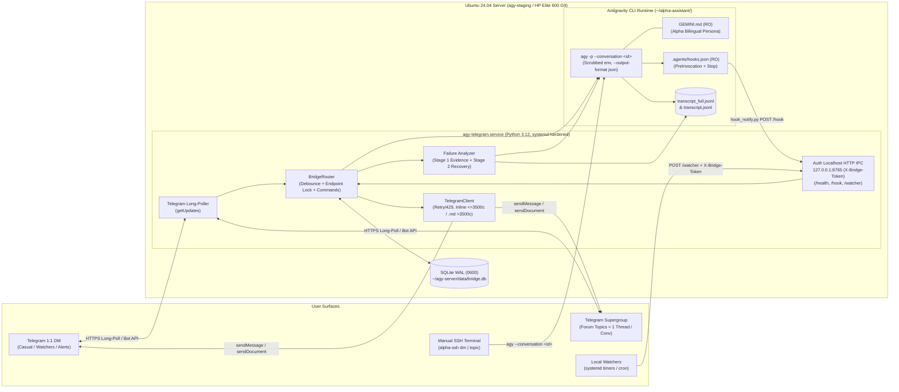

<!-- Copyright (c) 2026 zyecheng | SPDX-License-Identifier: BSD-3-Clause -->

# Alpha 24/7 Home AI Server — Architecture & Design Document

> **Status:** v1.2 Hardened + Interactive Telegram Approvals (`PreToolUse`) on Staging VM (`agy-staging`)  
> **Repository:** `agy-home-server`  
> **Last Updated:** 2026-11-26

---

## 1. Goals & Design Principles

Build a reliable, 24/7 personal home AI server powered by Antigravity CLI (`agy`) with a dedicated **Alpha** persona, staged first on a disposable VirtualBox Ubuntu 24.04 VM (`agy-staging`) and designed for lift-and-shift deployment to physical hardware (**HP Elite 600 G9 Mini PC**: i5-12500T, 24 GB RAM, 256 GB NVMe, Intel vPro/AMT).

Core principles:
- **Thin, zero-dependency runtime:** Bridge runs purely on Python 3.12 stdlib + SQLite (WAL) — fast startup, low memory footprint (~25 MB for the bridge, ~300 MB total idle VM RAM).
- **Native Antigravity customization:** Persona (`GEMINI.md`), SSH synchronization (`hooks.json`), and workspace automation (`.agents/skills/staging-vm/`) use Antigravity's built-in primitives rather than external wrapper frameworks.
- **Transcript as source of truth:** All turns (Telegram, SSH, or proactive watchers) flow into `agy`'s persistent `transcript_full.jsonl` / `transcript.jsonl`, enabling deterministic deduplication, SSH-to-Telegram mirroring, and structured failure recovery.
- **Defense-in-depth security:** Mandatory user allowlisting (`TELEGRAM_ALLOWED_USER_IDS`), scrubbed child process environments (no bot token leakage), authenticated loopback IPC (`X-Bridge-Token` + `application/json`), canonical `transcriptPath` containment, and `systemd` service sandboxing (`NoNewPrivileges=yes`, `ProtectSystem=strict`, `InaccessiblePaths=/home/agy/.ssh`).

---

## 2. High-Level System Architecture



---

## 3. Two-Instance Workspace Layout & Isolation

To keep personal Alpha interactions isolated from plain engineering/admin work and prevent agent turns from tampering with secrets or escalating privileges:

```text
/home/agy/
├── alpha-assistant/                 # Dedicated Alpha workspace (CWD for bridge & alpha-ssh)
│   ├── GEMINI.md                    # Read-only to systemd service; Alpha bilingual persona
│   ├── .agents/
│   │   └── hooks.json               # Read-only to systemd service; PreInvocation + Stop hooks
│   ├── memory/                      # (Reserved) USER.md / MEMORY.md / STATE.md
│   └── inbox/                       # (Reserved) Staged multimodal attachments per conv_id
├── agy-server/                      # Read-only to systemd service (except data/)
│   ├── .env                         # 0600 secrets (loaded directly, never exported to child env)
│   ├── data/                        # 0700 writable runtime directory
│   │   ├── bridge.db                # 0600 SQLite WAL database
│   │   └── ipc.token                # 0600 shared secret for localhost IPC auth
│   ├── server/                      # Python bridge package
│   ├── systemd/                     # Hardened systemd unit template
│   └── tests/                       # Unit & integration tests
└── .gemini/antigravity-cli/
    ├── antigravity-oauth-token      # 0600 persisted Google OAuth refresh token (survives reboot)
    ├── settings.json                # CLI permission & workspace settings
    └── brain/<conv_id>/.system_generated/logs/
        ├── transcript.jsonl         # Compact trajectory log
        └── transcript_full.jsonl    # Full untruncated trajectory log (preferred by bridge)
```

**Service Isolation (`systemd/agy-telegram.service`):**
- `NoNewPrivileges=yes`, `RestrictSUIDSGID=yes`, `CapabilityBoundingSet=` block `sudo` escalation from any bridge-spawned `agy` subprocess even when the `agy` OS user has `sudo` for SSH admin deploys.
- `ProtectSystem=strict`, `PrivateTmp=yes`, `UMask=0077`, `InaccessiblePaths=/home/agy/.ssh`, `ReadOnlyPaths=/home/agy/agy-server /home/agy/alpha-assistant/.agents/hooks.json /home/agy/alpha-assistant/GEMINI.md`, and `ReadWritePaths=/home/agy/agy-server/data /home/agy/alpha-assistant /home/agy/.gemini/antigravity-cli`.
- **Production hardening (HP Elite 600 G9):** Run `agy-telegram.service` under a dedicated non-sudo service user separate from the SSH admin account.

---

## 4. Conversation Routing & Database Schema

### 4.1 Mapping Patterns
| Usage Pattern | Telegram Identifier | Normalized Key (`bindings`) | Behavior |
| --- | --- | --- | --- |
| **1:1 DM** | `chat_type="private"`, `chat_id=<user_id>` | `("telegram", chat_id, thread_id=0)` | Single persistent Alpha conversation; also default target for `/watcher` alerts. |
| **Supergroup Forum Topic** | `chat_type="supergroup"`, `message_thread_id=N` | `("telegram", chat_id, thread_id=N)` | Lazily creates an independent `agy` conversation on first message; tracks `forum_topic_created` and `forum_topic_edited` names. |
| **Supergroup General Topic** | `message_thread_id` omitted or `1` | `("telegram", chat_id, thread_id=1)` | Outgoing Bot API calls omit `message_thread_id` when `thread_id <= 1`. |

### 4.2 SQLite Schema (`server/db.py`, WAL mode, `0600`, `busy_timeout=5000`, `user_version=1`)
- **`bindings`**:
  - `id`, `channel`, `chat_id`, `thread_id`, `chat_type`, `topic_name`
  - `agy_conversation_id` (populated on first `agy -p` turn)
  - `workspace_dir` (defaults to `ALPHA_WORKSPACE`)
  - `mirror_mode` (`full` | `replies_only` | `muted`, default `full`)
  - `last_mirrored_step` (monotonic watermark against `transcript_full.jsonl` `step_index`)
  - `active` (`1` = current binding; `0` = archived via `/reset`, preserving old transcripts on disk)
  - Partial unique index on `(channel, chat_id, thread_id) WHERE active = 1`
- **`message_log`**: Local audit log (`direction`, `origin`, `external_message_id`, `agy_step_index`, `content_preview`, `attachments_json`).
- **`kv_state`**: Persists `telegram_offset` across restarts. On `SIGTERM`, `router.shutdown()` flushes pending debounce batches and joins active workers before closing SQLite (`TimeoutStopSec=45`).
- `alpha-ssh` opens `bridge.db` in SQLite read-only URI mode (`?mode=ro`) to avoid running DDL against the live daemon database.

---

## 5. Turn Lifecycle & Concurrency Flows

### 5.1 Telegram Inbound Turn (`server/router.py`)
1. **Authorization:** Requires non-empty `TELEGRAM_ALLOWED_USER_IDS` in live mode (fails closed even if `TELEGRAM_ALLOWED_CHAT_IDS` is set), rejects `is_bot=True` senders, and enforces optional `TELEGRAM_ALLOWED_CHAT_IDS` as an additional restriction.
2. **Control Commands:**
   - **Zero-LLM local commands:** `/status`, `/mirror`, `/reset`, `/id`, `/help` execute locally without invoking `agy`.
   - **CLI-backed command:** `/compact` acquires the endpoint lock, waits for any active SSH turn, and invokes `agy -p /compact --conversation <id>` (uses LLM compaction quota).
   - `/reset` cancels pending debounce timers for the endpoint and archives the active binding under the endpoint lock.
3. **Debounce Coalescing:** Normal messages wait `DEBOUNCE_SECONDS` (`1.5s`) per `(channel, chat_id, thread_id)` using monotonic generation counters so superseded timers never steal or orphan newer batches.
4. **SSH Busy Wait + Endpoint Lock:** Waits for any active SSH turn **outside** the endpoint lock (preventing deadlocks with `Stop` hook mirroring), then acquires the lock keyed by `(channel, chat_id, thread_id)` and reconciles any un-mirrored SSH/offline steps before executing.
5. **Continuous Typing Indicator:** Sends `sendChatAction(typing)` every 4s across both the primary `agy -p` call **and** any failure-recovery turn.
6. **Headless Execution (`server/agy_runner.py`):** Runs `agy -p "<envelope>" [--conversation <id>] --output-format json --disable-slash-commands` in `~/alpha-assistant/` with a scrubbed environment (`TELEGRAM_*` and `BRIDGE_IPC_*` stripped, `AGY_BRIDGE_ORIGIN=bridge` set).
   - Timestamps use Python stdlib `ZoneInfo(BRIDGE_TIMEZONE)` (automatic PST/PDT). Envelope header values strip brackets and newlines to prevent header spoofing.
   - `subprocess.TimeoutExpired` is caught and returned as `AgyResult(status="TIMEOUT")` into the failure analyzer; `AGY_TIMEOUT_SECONDS=0` disables the subprocess timeout (`None`).
7. **Delivery (`server/telegram_client.py`):**
   - Bounded retries on transient network errors, HTTP 5xx, and HTTP 429 (`retry_after`), verifying `"ok": true`.
   - `<= 3,500` chars → `sendMessage` inline.
   - `> 3,500` chars → uploads `alpha-reply-<timestamp>.md` via multipart `sendDocument` with a **2-line preview caption** + character count.
8. **Watermark Advance:** Updates `bindings.last_mirrored_step` **only after** Telegram delivery succeeds.

### 5.2 Direct SSH Session → Telegram Sync

```mermaid
sequenceDiagram
    participant User as User (SSH: alpha-ssh dm)
    participant AGY as agy CLI (~/alpha-assistant)
    participant Hook as hook_notify.py
    participant Bridge as agy-telegram.service (127.0.0.1:8765)
    participant TG as Telegram Chat/Topic

    User->>AGY: Interactive prompt (scrubbed env, AGY_BRIDGE_ORIGIN unset)
    AGY->>Hook: PreInvocation hook (stdin JSON)
    Hook->>Bridge: POST /hook + X-Bridge-Token {event: PreInvocation, conversationId}
    Bridge-->>Bridge: Verify active binding & mark SSH-busy
    AGY-->>User: Streams reply in terminal & appends transcript_full.jsonl
    AGY->>Hook: Stop hook {conversationId, transcriptPath, fullyIdle}
    Hook->>Bridge: POST /hook + X-Bridge-Token {event: Stop, ...}
    Bridge-->>Hook: 200 queued_mirror (returns immediately; never stalls SSH)
    Bridge->>Bridge: If fullyIdle=true, async worker validates transcriptPath inside brain_dir
    alt mirror_mode == "full"
        Bridge->>TG: Silent sendMessage: "[SSH] <prompt snippet>"
        Bridge->>TG: Silent sendMessage / .md upload: "<Alpha reply>"
    else mirror_mode == "replies_only"
        Bridge->>TG: Silent sendMessage / .md upload: "[SSH] <Alpha reply>"
    else mirror_mode == "muted"
        Bridge-->>Bridge: Advance watermark only
    end
    Bridge-->>Bridge: Advance last_mirrored_step per delivered turn & clear SSH-busy
```

- **Localhost IPC Security (`server/bot.py`):** Refuses non-loopback `BRIDGE_IPC_HOST`; requires `X-Bridge-Token` (constant-time `hmac.compare_digest` against `0600` `data/ipc.token`), `Content-Type: application/json` (prevents browser CORS simple-POST CSRF), body cap `<= 1 MiB`, and JSON object validation.
- **Path Containment (`server/transcript.py`):** Rejects unsafe `conversation_id` values and validates any caller-supplied `transcriptPath` via canonical `Path.resolve().is_relative_to(brain_dir/<conv_id>/.system_generated/logs)`.
- **`hook_notify.py`:** Loads fallback IPC host/port/token from `~/agy-server/.env` and `data/ipc.token`, ignores `AGY_BRIDGE_ORIGIN=bridge`, and always emits valid non-blocking hook JSON on stdout.

### 5.3 Two-Stage Failure Analysis & Alpha Recovery (`server/failure_analyzer.py`)
1. **Stage 1 — Deterministic Evidence Extraction:** Inspects new `transcript_full.jsonl` steps (`tool_calls` and `status == "ERROR"`), `AgyResult.error`, and `AgyResult.stderr` via an ordered regex rule table (`permission_denied`, `auth_required`, `quota_or_rate_limit`, `timeout`, `tool_error`, `empty_response`).
2. **Stage 2 — Guarded In-Conversation Alpha Explanation:** For recoverable categories *when a `conversation_id` already exists*, runs **one** bounded (`45s`) recovery prompt wrapping untrusted user/error text inside `<untrusted_data>` delimiters so Alpha explains the failure in the user's language (`[category | step N]`).
3. **Deterministic Fallback:** Skips Stage 2 for `auth_required`, `quota_or_rate_limit`, or missing `conversation_id` (preventing orphan conversations), and falls back automatically to Stage 1's clean report if Stage 2 fails.

---

## 6. Infrastructure, Deployment & Windows Host Guardrails

### 6.1 Staging Environment (`agy-staging`)
- **Hypervisor:** Oracle VirtualBox 7.2.22 on Windows 11 host (Lenovo Legion Y740).
- **Guest OS:** Ubuntu 24.04.5 LTS Cloud Image (`noble-server-cloudimg-amd64.ova`) provisioned via native PowerShell `IMAPI2FS` `cidata.iso` (`scripts/build-cidata-iso.ps1` + `scripts/setup-vm.ps1`, using `$PSScriptRoot`-relative defaults).
- **Specs:** 1 vCPU, 3072 MB RAM, NAT `127.0.0.1:2222 -> 22`, `journald` capped at `500M`, passwordless SSH key `~/.ssh/id_ed25519_agy`.
- **Windows WHPX/NEM Guardrails:** Keep `1 vCPU` under WHPX NEM (avoids Linux 6.8 SMP boot spinlock); always take **cold** snapshots (`sudo poweroff` before snapshotting).

### 6.2 Deployment & Secrets Pipeline
- **`scripts/deploy.ps1`:** Packs repo to a local temp `.tar.gz`, uploads to a randomized archive inside user-owned `$RemoteDir` (never world-writable `/tmp`), cleans up via `trap`, normalizes CRLF → LF, syncs `alpha-workspace/` → `~/alpha-assistant/`, links `alpha-ssh`, runs `systemctl enable` + `systemctl restart`, and verifies `GET /health`.
- **`scripts/set-bot-token.ps1` + `server/set_env.py`:** Masked WinForms dialog pipes secrets into `tempfile.mkstemp` (`0600` exclusive) atomic replacement of `~/agy-server/.env`, checking exit codes on both service restart and `/health`.
- **Auth Persistence:** `agy` CLI persists Google OAuth refresh tokens to `~/.gemini/antigravity-cli/antigravity-oauth-token` (`0600`), surviving full server reboots unattended.

---

## 7. Repository Map

| Path | Responsibility |
| --- | --- |
| `GEMINI.md` | Always-on workspace rules & Windows/VM guardrails |
| `.agents/skills/staging-vm/` | Antigravity skill + `vm.ps1` lifecycle CLI |
| `alpha-workspace/GEMINI.md` | Alpha bilingual persona deployed to `~/alpha-assistant/` |
| `alpha-workspace/.agents/hooks.json` | Antigravity `PreInvocation`, `Stop`, and `PreToolUse` hook config |
| `server/bot.py` | Main daemon: Telegram long-poller + authenticated `127.0.0.1:8765` IPC (`/health`, `/hook`, `/approve`, `/watcher`) |
| `server/config.py` | `.env` parser (no `os.environ` mutation), validation, `0600` IPC token helper |
| `server/router.py` | Endpoint-locked router, generation-guarded debouncer, commands, approval & SSH sync handlers |
| `server/approvals.py` | Lock-free, fail-closed Telegram inline-button approval manager (120s TTL, single-use nonce) |
| `server/db.py` | SQLite WAL store (`bindings`, `message_log`, `kv_state`, read-only URI mode) |
| `server/agy_runner.py` | Headless `agy -p` subprocess wrapper, scrubbed env (`AGY_BRIDGE_ORIGIN`, `AGY_BRIDGE_BINDING_ID`), `ZoneInfo` timestamps |
| `server/failure_analyzer.py` | Two-stage failure classifier + delimited Alpha recovery prompt builder |
| `server/transcript.py` | Contained `transcript_full.jsonl` / `transcript.jsonl` streaming parser |
| `server/telegram_client.py` | Stdlib Telegram Bot API client (retry/429, inline keyboards/callbacks, `.md` upload >3,500 chars) |
| `server/hook_notify.py` | Non-blocking authenticated `PreInvocation`/`Stop` hook → localhost IPC forwarder |
| `server/hook_approve.py` | Strictly fail-closed `PreToolUse` hook → `POST /approve` Telegram approval gate |
| `server/alpha_ssh.py` | Read-only SSH helper CLI (`alpha-ssh`) with exact numeric ID matching |
| `server/set_env.py` | Exclusive `0600` atomic `.env` updater |
| `scripts/deploy.ps1` | Binary-safe Windows → Linux deployment script with `/health` verification |
| `scripts/setup-vm.ps1` & `build-cidata-iso.ps1` | Reproducible VirtualBox + `cloud-init` provisioning |
| `scripts/set-bot-token.ps1` | Masked Windows GUI secret injector |
| `systemd/agy-telegram.service` | Hardened `systemd` unit for 24/7 auto-restart |
| `tests/test_bridge.py` | Unit & integration test suite (17 tests) |

---

## 8. Security Contracts & Planned Next Milestones

1. **Headless Tool Permissions & Timezone (immediate):**
   - Set VM timezone to `America/Los_Angeles` and configure `~/.gemini/antigravity-cli/settings.json` with least-privilege allowlists (or `always-proceed` **only** in tandem with the `systemd` isolation above + `PreToolUse` approval gates below — never relying on command denylists alone).
2. **Interactive Telegram Approvals (`PreToolUse` Hook — Implemented in v1.2):**
   - Separate strictly fail-closed `server/hook_approve.py` + lock-free `server/approvals.py` (`POST /approve` with `X-Bridge-Token`).
   - Passes `AGY_BRIDGE_BINDING_ID` into headless `agy -p` turns so Turn-1 tool calls resolve the target Telegram chat/topic before `agy_conversation_id` is saved.
   - Enables `callback_query` in `allowed_updates`, authenticates `callback_query.from.id` + `chat_id` server-side, binds each button to a single-use 24-hex nonce + tool/args SHA-256 digest + 120s TTL, and fails closed to `deny` on timeout, IPC error, or daemon shutdown. Manual SSH sessions (`AGY_BRIDGE_ORIGIN` unset) pass through via `allow`.
3. **Multimodal Telegram Inputs:**
   - Download incoming photos, files, voice notes, and locations into `~/alpha-assistant/inbox/<conv_id>/` with sanitized filenames, canonical `is_relative_to` confinement, max file size caps, and automated TTL pruning (disk hygiene for 256 GB NVMe).
4. **Memory, Retention & Watchers:**
   - Populate `~/alpha-assistant/memory/{USER.md,MEMORY.md}`, add a daily OAuth/quota watchdog calling `POST /watcher` with `X-Bridge-Token`, and schedule SQLite backups + retention pruning for archived transcripts and `message_log`.
5. **Gmail Adapter (Channel Trust Tiers):**
   - Because inbound emails contain untrusted third-party content, untrusted channels **must** run in a separate read-only/restricted tool profile (no shell, no workspace writes, no outbound email send without explicit `PreToolUse` Telegram approval) before connecting `gmail_adapter`.
6. **Hardware Cutover (HP Elite 600 G9 Mini PC):**
   - Provision Ubuntu 24.04 via Intel vPro/AMT IDER or `CIDATA` USB; separate admin sudo user from bridge service user; enable host firewall (`ufw` allowing SSH only from LAN/VPN); enable TLS or disable Intel AMT post-provisioning; document full-disk encryption and Telegram/OAuth secret rotation; deploy via `.\scripts\deploy.ps1 -TargetHost hp-agy`.
