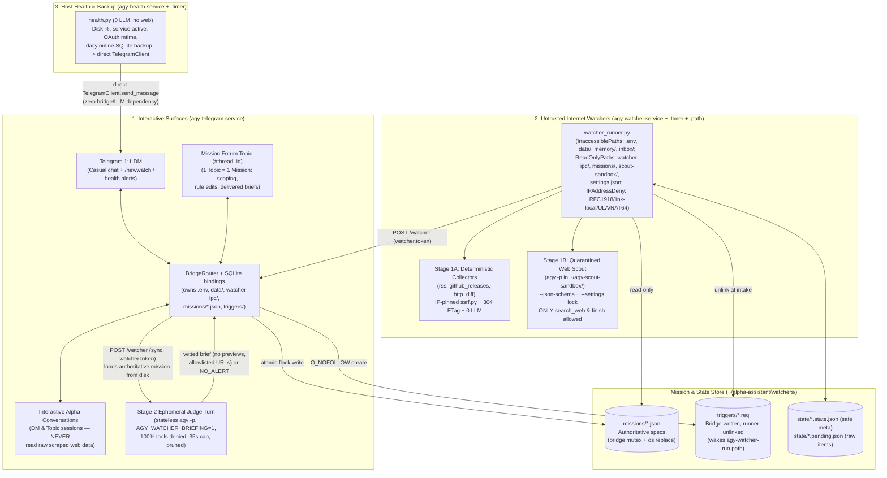

<!-- Copyright (c) 2026 zyecheng | SPDX-License-Identifier: BSD-3-Clause -->

# Proactive Watchers & Intel Scout Engine — Design Document

> **Status:** Approved v1.0 (Design Review Passed — 0 Blocking Findings)  
> **Repository:** `agy-home-server`  
> **Related:** [ARCHITECTURE.md](ARCHITECTURE.md)  
> **Last Updated:** 2026-11-27

---

## 1. Problem Statement & Design Goals

A 24/7 personal AI assistant (**Alpha**) differs fundamentally from a passive on-demand coding agent (**vanilla `agy`**) in two ways:
1. **Asynchronous long-horizon monitoring:** Users dispatch open-ended or structured watch tasks that run for days, weeks, or months in the background and report back on Telegram only when something meaningful changes.
2. **Ambiguous, human-specified rules:** Real personal requests rarely come with a clean API endpoint or RSS feed (for example: *"watch for piano lessons for a 6-year-old within 10 miles of Mountain View"*). The assistant must help clarify ambiguity up front, translate vague intent into a concrete monitoring plan, execute asynchronously without blocking normal chat, adapt to user feedback, and eventually wind down once resolved.

### Core Goals
- **Interactive scoping before activation:** When a request is underspecified, Alpha asks 2–3 high-leverage clarifying questions, proposes a concrete monitoring strategy (sources, cadence, stop condition, notification policy), and activates only after user approval.
- **Non-blocking, context-isolated execution:** Background scouts never acquire Alpha's main DM lock, never stall interactive Telegram replies, and never inject raw scraped web pages or suppressed `NO_ALERT` turns into Alpha's persistent interactive conversations.
- **Right-time proactivity (zero spam):** Deterministic deduplication (`seen_ids` + validated slug `known_entities`), quiet hours with independent morning flush, exponential backoff, 30-day check-ins, and an ephemeral Stage-2 `NO_ALERT` gate prevent notification fatigue.
- **Cost & quota discipline:** Deterministic collectors (`rss`, `github_releases`, `http_diff`) and the dedicated `agy-health.service` spend **0 LLM tokens** on unchanged ticks (and `agy-health.service` alerts directly via `TelegramClient` with zero bridge-daemon or LLM dependency); open-web LLM scouts enforce per-mission cadence, daily run caps, per-tick budgets, and failure backoff.
- **CaMeL security by design:** Untrusted internet content is processed in a read-only **quarantined scout workspace** (`~/agy-scout-sandbox/`) under a locked-down `systemd` unit (`agy-watcher.service`) with `InaccessiblePaths` hiding `.env`, the entire `data/` directory (`bridge.db*`, `backups/`, `ipc.token`), `memory/`, and `inbox/`, read-only global `settings.json`, kernel-level `IPAddressDeny`, and a `PreToolUse` hook allowing **only `search_web` and `finish`**. Stage-2 briefing executes in an **ephemeral stateless turn** with `AGY_WATCHER_BRIEFING=1` hard-denying **100% of tools**, Telegram link previews disabled, and outbound URLs/`tg://` links restricted to Stage-1-observed `http(s)` links.

### Non-Goals (v1)
- Autonomous transactional actions (e.g., auto-enrolling in a class, purchasing items, submitting web forms, or sending outbound emails). Watchers are strictly **observe, filter, advise, and notify**.
- Heavy external infrastructure (no Redis, Celery, Kafka, or separate vector DB). Runs purely on Python 3.12 stdlib, JSON state files / SQLite, `agy -p`, and `systemd` timers.
- Separate `digest` rolling cadence or custom `json_path` query language (weekly/biweekly missions naturally emit a single bundled brief; `http_diff` uses normalized HTML/text + optional `regex` and `match_keywords`).

---

## 2. Real-World User Journeys (6 Archetypes)

| # | Archetype | Example Request | Ambiguity / Scoping Needed | Collector Tier | Urgency & Delivery | Lifecycle / Closure |
| --- | --- | --- | --- | --- | --- | --- |
| **1** | **Open-Ended Local Discovery** | *"Watch for piano lessons for a 6-year-old within 10 miles of Mountain View."* | Private 1:1 vs. group? Budget/weekend constraints? Specific openings/reviews vs. directory sweep? | **Tier B (`web_scout`)** + optional separate `http_diff` for a known school URL | Weekly or twice-weekly; normal priority; dedupe by **studio/teacher entity slug**, not raw HTML hash | User refines (*"drop east of 101"*) and eventually closes (*"we enrolled"*) |
| **2** | **Seasonal Registration / Waitlist Sniping** | *"Alert me as soon as city rec summer swim classes open for registration."* | Exact age bracket, facility, registration portal URL, target window (e.g., March–April) | **Tier A (`http_diff`)** on portal URL, fallback **Tier B (`web_scout`)** | **Urgent** during window (overrides quiet hours); high frequency (30–60 min) | Auto-expires at `expires_at` or once user confirms enrolled |
| **3** | **Deal / Price Threshold Monitoring** | *"Watch for an HP Elite 600 G9 Mini (24 GB+ RAM) under \$450."* | Condition (new/refurb/used), acceptable sources (Slickdeals RSS, Reddit RSS, web search), hard price ceiling | **Tier A (`rss`)** + **Tier B (`web_scout`)** with price threshold | Normal (quiet hours respected); cross-run dedupe so same listing isn't repeated | Closes when purchased or after 60-day check-in |
| **4** | **Software / Ecosystem Release Tracking** | *"Track Antigravity CLI releases and tell me if hooks or remote-control change."* | Specific keywords/areas of interest, repo/changelog URL | **Tier A (`github_releases` / `rss` / `http_diff`)** with `ETag` conditional caching | Normal; **0 LLM tokens** when unchanged; Stage-2 explains concrete impact | Long-running (indefinite with periodic check-in) |
| **5** | **Slow-Moving Policy / Life Intel** | *"Keep an eye on local school district enrollment deadlines or EV rebate updates."* | District/state, exact topic scope, weekly/biweekly cadence | **Tier B (`web_scout`)** | Normal priority (quiet hours respected; weekly/biweekly run naturally emits a single summary) | Auto-check-in every 30–60 days |
| **6** | **Home Server Self-Health & SQLite Backup** | *(Built-in `agy-health.timer`)* Disk > 85%, `agy-telegram.service` down, `agy` OAuth missing/stale, daily SQLite online backup | None (deterministic thresholds) | **Dedicated `agy-health.service`** (0 LLM, direct `TelegramClient`) | **Urgent** on state transition (with 6h repeat cooldown + recovery notice); 100% silent when healthy | Permanent |

### Walkthrough of Journey #1 (Vague Local Discovery — 1-Topic-Per-Mission Workflow)
1. **User (1:1 Telegram DM):** Runs `/newwatch MV Piano Lessons (6yo)` (0 LLM tokens, 0 approval prompts) OR writes naturally: *"Start a watcher for piano lessons for a 6-year-old around Mountain View (<10 miles)."*
2. **Spawn Dedicated Mission Topic (`createForumTopic`):**
   - `/newwatch` directly (or Alpha via `python3 -m server.watchers topic create ...`, calling authenticated `POST /watcher/topic` with `ipc.token`) invokes Telegram Bot API `createForumTopic` in `WATCHER_FORUM_CHAT_ID`.
   - The bridge atomically creates `watchers/missions/<slug>.json` using `O_CREAT|O_EXCL` (`status: "scoping"`, storing `initial_request`, optional `opening_questions`, and `notify.target = {"chat_id": "<forum_id>", "thread_id": <tid>}`), creates the SQLite `bindings` row with `mission_id = <slug>`, posts the opening context inside the new topic, and replies in the 1:1 DM with a **1-tap deep link** (`https://t.me/c/<internal_id>/<thread_id>`).
   - *(DM natural-language initiation runs `python3 -m server.watchers topic create` via approval-gated shell; `/newwatch <title>` creates the topic instantly with 0 approval prompts.)*
3. **Interactive Scoping Inside the Mission Topic (1–2 quick turns, zero context loss):**
   - On Turn 1 inside the new topic (`agy_conversation_id IS NULL`), `BridgeRouter` injects `initial_request`, `opening_questions`, and `[mission: <id> | status: scoping | ...]` into `format_channel_envelope`, so Alpha has the full DM request immediately.
   - Alpha asks at most 2–3 clarifying questions if needed (skipping interrogation for already-specific requests).
4. **Mission Activation (Non-Blocking):**
   - Alpha proposes the concrete plan (seed queries, weekly cadence, quiet hours, 30-day check-in) and updates `watchers/missions/mv-piano-6yo.json` to `status: "active"` (gated by Telegram `[Approve]`).
5. **Async Execution in Isolated Background Process (Week 1 — Never Blocks the Topic):**
   - `agy-watcher.timer` runs `python3 -m server.watchers.runner` inside the sandboxed `agy-watcher.service`.
   - Stage 1B (`web_scout`) runs `agy -p` in read-only `~/agy-scout-sandbox/` (`search_web` + `finish` only), returns schema-validated JSON; runner deduplicates via `state/mv-piano-6yo.state.json`, persists delta items into `state/mv-piano-6yo.pending.json`, and POSTs synchronously to `POST /watcher` using `watcher.token`.
   - Stage 2 runs an **ephemeral stateless `agy -p` briefing turn** (`AGY_WATCHER_BRIEFING=1`, **100% tools denied**, 35s bounded timeout). If relevant, the bridge delivers the vetted brief into the Mission Topic (`link_preview_options={"is_disabled": True}`) and returns `{"status": "delivered"}`; only then does `watcher_runner.py` advance `seen_ids`/`known_entities` and clear `pending.json`.
6. **In-Thread Rule Refinement (Weeks Later):**
   - User replies inside the Mission Topic: *"Tighten the radius from 10 miles to 5 miles and skip anything east of 101."*
   - Because the topic's SQLite binding has `mission_id = "mv-piano-6yo"` and its interactive conversation was never polluted by raw Stage-1 web data or `NO_ALERT` turns, Alpha cleanly reads `watchers/missions/mv-piano-6yo.json` and proposes the updated criteria/exclusions (approval-gated).
7. **Noise Suppression (Week 2):**
   - Scout finds the same studios + 1 studio 8 miles away. Slug/URL dedupe drops known studios; ephemeral Stage-2 judge replies `NO_ALERT` → bridge logs suppression, prunes the ephemeral Stage-2 brain dir, returns `{"status": "suppressed"}`, and sends **zero Telegram messages**.
8. **Lifecycle Closure (`closeForumTopic`):**
   - After 30 days (check-in prompt) or when user runs `/watch archive` (or tells Alpha *"we enrolled, archive this"* → `python3 -m server.watchers topic archive --id mv-piano-6yo`), the bridge atomically sets `status: "archived"` and calls Telegram `closeForumTopic`.

---

## 3. System Architecture & Isolation Boundaries



### Three Separate OS Execution Domains & Systemd Hardening
1. **`agy-telegram.service`** (existing bridge daemon — update `ReadWritePaths=` in `systemd/agy-telegram.service` to include `/home/agy/agy-server/watcher-ipc`):
   - Owns `.env`, `data/` (`bridge.db`, `ipc.token`, `backups/`, `health_state.json`), `watcher-ipc/` (`watcher.token`, `watcher.env`), `missions/*.json`, and `triggers/`.
   - On startup, writes two `0600` files atomically into `/home/agy/agy-server/watcher-ipc/`:
     - `watcher.token`: dedicated random 32-byte hex token accepted **exclusively** on `POST /watcher`.
     - `watcher.env`: non-secret runtime settings exported from `BridgeConfig` (`BRIDGE_IPC_HOST`, `BRIDGE_IPC_PORT`, `BRIDGE_TIMEZONE`, `WATCHER_QUIET_START`, `WATCHER_QUIET_END`, `MAX_DAILY_WEB_SCOUTS`, `AGY_BIN`, `AGY_MODEL`, `SCOUT_SANDBOX_DIR`, `WATCHER_MISSIONS_DIR`, `WATCHER_STATE_DIR`, `WATCHER_TRIGGERS_DIR`) — so `agy-watcher.service` NEVER touches `.env`!
   - Never executes untrusted collectors or `web_scout`. `/watch run [id]` writes `watchers/triggers/<id>.req` (using `O_CREAT|O_NOFOLLOW|O_WRONLY` after verifying `not triggers_dir.is_symlink()`) to wake `agy-watcher-run.path`.
   - Reads `watchers/state/<id>.state.json` (for `/watches` and `/watch status`) exclusively via `O_RDONLY|O_NOFOLLOW`, verifying `S_ISREG(fstat.st_mode)`, canonical `is_relative_to(state_dir)`, and a strict **256 KiB** read cap.
2. **`agy-watcher.service` + `agy-watcher.timer` + `agy-watcher-run.path`** (untrusted internet collectors: `rss`, `github_releases`, `http_diff`, `web_scout`):
   - `Environment=BRIDGE_ENV_FILE=/home/agy/agy-server/watcher-ipc/watcher.env` (`server/config.py`'s `parse_dotenv` also treats `PermissionError` like a missing file as defense in depth).
   - Full systemd hardening parity with `agy-telegram.service`:
     - `ProtectSystem=strict`, `NoNewPrivileges=yes`, `PrivateTmp=yes`, `PrivateDevices=yes`, `ProtectKernelTunables=yes`, `ProtectKernelModules=yes`, `ProtectControlGroups=yes`, `RestrictSUIDSGID=yes`, `CapabilityBoundingSet=`, `UMask=0077`
     - `InaccessiblePaths=/home/agy/.ssh /home/agy/agy-server/.env /home/agy/agy-server/data /home/agy/alpha-assistant/memory /home/agy/alpha-assistant/inbox` (masking the **entire** `data/` directory hides `bridge.db`, `bridge.db-wal`, `bridge.db-shm`, `ipc.token`, `backups/`, and `health_state.json` cleanly with zero `-` prefix race!).
     - `ReadOnlyPaths=/home/agy/agy-server /home/agy/agy-server/watcher-ipc /home/agy/alpha-assistant/watchers/missions /home/agy/agy-scout-sandbox -/home/agy/.gemini/antigravity-cli/settings.json` (both `~/agy-scout-sandbox/` and global `settings.json` are read-only!).
     - `ReadWritePaths=/home/agy/alpha-assistant/watchers/state /home/agy/alpha-assistant/watchers/triggers /home/agy/.gemini/antigravity-cli`
     - `IPAddressDeny=0.0.0.0/8 10.0.0.0/8 172.16.0.0/12 192.168.0.0/16 100.64.0.0/10 169.254.0.0/16 224.0.0.0/4 fc00::/7 fe80::/10 ff00::/8 64:ff9b::/96 64:ff9b:1::/48` (loopback `127.0.0.1` remains reachable for `POST /watcher`; `ssrf.py` blocks loopback for all mission URLs and `web_scout` has no arbitrary URL fetch tool).
     - *(Boundary note: `agy` requires `~/.gemini/antigravity-cli/` for OAuth authentication and ephemeral session logs. Existing `brain/` transcripts are protected in `web_scout` by `hook_scout_guard.py` hard-denying 100% of filesystem, shell, and MCP tools + `--settings` pinning review policy + `--disable-slash-commands`, and `watcher_runner.py` immediately prunes each ephemeral scout brain dir after completion.)*
3. **`agy-health.service` + `agy-health.timer`** (every 15 min, **0 LLM, 0 external untrusted HTTP**):
   - Probes disk usage (`/` > 85%), `systemctl is-active agy-telegram.service`, OAuth token presence/mtime freshness, and performs/verifies the daily online SQLite backup (`sqlite3.Connection.backup()` of `data/bridge.db` → `data/backups/bridge-YYYY-MM-DD.db`, mode `0600`, rotating 7 days).
   - **Single direct delivery path (no bridge/LLM dependency):** Sends alerts directly via `TelegramClient.send_message(..., disable_web_page_preview=True)` using `.env` (target chat resolution order: read-only `BridgeStore.get_primary_dm_binding("telegram")` → first `TELEGRAM_ALLOWED_CHAT_IDS` → first `TELEGRAM_ALLOWED_USER_IDS`).
   - **Cooldown & recovery state:** Tracks active fault states & last-alert timestamps in `data/health_state.json` (`0600`), alerting on state transitions with a **6-hour repeat cooldown** and sending a recovery notice when cleared. On disk-full alerts, sends the Telegram alert **before** attempting to write `data/health_state.json`.
   - Hardening: `ProtectSystem=strict`, `NoNewPrivileges=yes`, `PrivateTmp=yes`, `PrivateDevices=yes`, `RestrictSUIDSGID=yes`, `CapabilityBoundingSet=`, `UMask=0077`, `InaccessiblePaths=/home/agy/.ssh`, `ReadOnlyPaths=/home/agy/agy-server /home/agy/.gemini/antigravity-cli`, `ReadWritePaths=/home/agy/agy-server/data`.

---

## 4. Data Model, Schemas & Lifecycle State Machine

### 4.1 Mission Spec (`watchers/missions/<id>.json`)
Slug invariant: `id` MUST match `^[a-z0-9][a-z0-9_-]{0,63}$`, and every file path MUST verify `resolved.is_relative_to(missions_dir.resolve())` with symlink rejection (`O_NOFOLLOW` / `not is_symlink()`). Because `agy-watcher.service` mounts `missions/` read-only, all bridge mutations to `missions/<id>.json` serialize on an in-process bridge-side per-mission `threading.Lock` (never `watchers/state/<id>.lock`, avoiding any cross-process deadlock during synchronous `POST /watcher` `expired` / `topic_deleted` callbacks) and write via atomic temp-file + `fsync` + `os.replace` (`0600`).

```json
{
  "schema_version": 1,
  "id": "mv-piano-6yo",
  "title": "Mountain View Piano Lessons (Age 6)",
  "status": "active",
  "kind": "web_scout",
  "created_at": "2026-11-27T08:00:00Z",
  "initial_request": "Watch for piano lessons for a 6-year-old around Mountain View (<10 miles).",
  "opening_questions": "1. Private 1-on-1, small group, or both?\n2. Any weekend/budget preference?",
  "schedule": {
    "interval_minutes": 10080
  },
  "config": {
    "queries": [
      "piano lessons 6 year old Mountain View CA reviews",
      "Mountain View recreation youth piano class registration"
    ],
    "max_items": 8
  },
  "relevance_criteria": "Beginner piano (1-on-1 or small group <=6 kids) within 10 miles of Mountain View, CA; weekends preferred.",
  "exclusions": [
    "East of Highway 101",
    "Online-only lessons"
  ],
  "notify": {
    "priority": "normal",
    "quiet_hours": null,
    "target": {
      "chat_id": "-1001234567890",
      "thread_id": 42
    }
  },
  "lifecycle": {
    "expires_at": null,
    "checkin_after_days": 30
  }
}
```

**Canonical `status` state machine & Forum Topic sync table (authoritative across all sections):**

| Current `status` | Event | Next `status` | Side Effects |
| --- | --- | --- | --- |
| `scoping` | User/Alpha activates (valid runnable config) | `active` | Scheduled by runner |
| `scoping` | `/watch archive` or `topic archive` | `archived` | `closeForumTopic` |
| `scoping` | Telegram `forum_topic_closed` / `forum_topic_reopened` | `scoping` (unchanged) | Never auto-activates unconfigured drafts |
| `active` | `/watch pause` or Telegram `forum_topic_closed` | `paused` | Skipped by runner; retains state |
| `active` | `/watch archive`, `topic archive`, or `expires_at` reached | `archived` | `closeForumTopic` |
| `paused` | `/watch resume`, `topic reopen`, or `forum_topic_reopened` (if runnable) | `active` | `reopenForumTopic` (for command/IPC) |
| `paused` | `/watch archive` or `topic archive` | `archived` | `closeForumTopic` |
| `archived` | `/watch resume`, `topic reopen`, or `forum_topic_reopened` (if runnable) | `active` | `reopenForumTopic` (for command/IPC) |
| `archived` | Telegram `forum_topic_closed` (including echo from `closeForumTopic`) | `archived` (unchanged) | Preserves `archived` status |

**Unified `notify.target` shape:**
- `null` (or omitted): deliver to `primary_dm`.
- `{"chat_id": "<str>", "thread_id": <int>}`: deliver to the bound Mission Topic (validated server-side against `WATCHER_FORUM_CHAT_ID`).

**`notify.quiet_hours` defaults:**
- `null` (default): inherits server-level `BRIDGE_TIMEZONE` + `WATCHER_QUIET_START` (`23:00`) / `WATCHER_QUIET_END` (`08:00`).
- `{"start": "HH:MM", "end": "HH:MM"}`: per-mission override (evaluated in `BRIDGE_TIMEZONE`).
- `{"disabled": true}`: never hold for quiet hours. (`priority: "urgent"` also overrides quiet hours.)

**Supported `kind` values (`agy-watcher.service`):**
- `"rss"`: RSS 2.0 / Atom XML feed polling (`url`, optional `match_keywords`, optional `max_items` default 8). Supports `ETag` / `Last-Modified` 304 caching and first-run baseline capping (`max_items` newest emitted, remaining older items marked seen).
- `"github_releases"`: GitHub repository releases API (`repo: "owner/name"`, optional `include_prereleases: false`, optional `max_items` default 5). Supports `ETag` 304 caching and first-run baseline capping.
- `"http_diff"`: Public webpage/JSON fetch (`url`, optional `regex`, optional `match_keywords`). Extracts normalized visible text via stdlib `html.parser` (stripping `<script>`, `<style>`, `<noscript>`, comments, and collapsing whitespace) so rotating CSRF tokens or markup churn do not trigger false alerts; hashes normalized text (or regex matches) and emits a compact diff item on change.
- `"web_scout"`: Open-ended internet scout using quarantined `agy -p` (`queries` list of 1–4 strings, optional `max_items` default 8). Minimum interval `>= 60 min`.

### 4.2 Split Runtime State (Safe Metadata vs. Untrusted Pending Queue)
Managed exclusively by `watcher_runner.py` under per-mission `flock` (`watchers/state/<id>.lock`) with atomic temp-file + `fsync` + `os.replace` (`0600`):
1. **Safe metadata (`watchers/state/<id>.state.json` — ZERO raw scraped web text):**
   ```json
   {
     "last_run_at": 1795750000.0,
     "next_run_at": 1796354800.0,
     "last_notified_at": 1795750012.0,
     "last_checkin_at": 1795750000.0,
     "consecutive_failures": 0,
     "last_error": "http_timeout",
     "http_etag": "\"abc123\"",
     "http_last_modified": "Thu, 26 Nov 2026 08:00:00 GMT",
     "last_hash": "sha256:...",
     "seen_ids": ["sha256:..."],
     "known_entities": [
       {"key": "csma-arts4all", "url_hash": "sha256:...", "first_seen": "2026-11-26", "outcome": "delivered"}
     ],
     "pending_count": 0
   }
   ```
   - `last_error` stores only a bounded, sanitized error category/code (`<= 120` chars, never raw HTTP response bodies).
   - `last_checkin_at` initializes from mission `created_at` (or first run timestamp), never `0`.
   - `seen_ids` capped at 500 entries (FIFO ring), `known_entities` capped at 100 entries (strict slug `key` regex `^[a-z0-9][a-z0-9_-]{0,63}$`, strict `YYYY-MM-DD` `first_seen`, and strict `outcome` enum `"delivered"` | `"suppressed"`). All up to 100 validated entries are injected into **both** Stage-1 `web_scout` and Stage-2 judge prompts so cross-URL/alias duplicates are caught without ever persisting untrusted web prose.
2. **Untrusted pending delivery queue (`watchers/state/<id>.pending.json` — touched ONLY by `watcher_runner.py`, NEVER read by interactive Alpha or `/watch status`):**
   - Stores at most 50 queued Stage-1 items awaiting morning quiet-hours flush or retry after a failed `POST /watcher` attempt.
3. **Global runner metadata (`watchers/state/_runner_meta.json`, short-lived `_runner_meta.lock`):**
   - Tracks `{"date": "YYYY-MM-DD", "web_scout_runs": 0}` in `BRIDGE_TIMEZONE` to enforce `MAX_DAILY_WEB_SCOUTS` (default `12`), resetting at `BRIDGE_TIMEZONE` midnight.

---

## 5. Stage-1 & Stage-2 Execution & Two-Phase Delivery

### 5.1 Scheduler Cadence, Priority, Triggers & Quiet-Hours Decoupling
- `agy-watcher.timer` fires every **5 minutes** (`OnUnitActiveSec=5m`, `RandomizedDelaySec=20s`), and `agy-watcher-run.path` (`DirectoryNotEmpty=/home/agy/alpha-assistant/watchers/triggers`) triggers immediately when `/watch run [id]` writes `watchers/triggers/<id>.req`.
- **Anti-spin-loop trigger intake:** At the start of every tick, `watcher_runner.py` reads and **unlinks every `*.req` file** in `watchers/triggers/` (even unknown, malformed, non-active, or currently-locked IDs) before executing queued missions, guaranteeing `DirectoryNotEmpty=` can never spin-loop.
- **Two independent due checks per tick:**
  1. **Pending delivery flush:** Any `active` mission with `pending_count > 0` (`<id>.pending.json` non-empty) that is now **outside quiet hours** (or `priority == "urgent"`) flushes immediately — **decoupled from `next_run_at`** so a weekly mission that ran at 23:30 flushes at 08:00 the next morning.
  2. **Collection due:** Triggered missions first, then due `active` missions (`now >= next_run_at`) sorted by `(priority != "urgent", kind == "web_scout", next_run_at)` — ensuring fast deterministic Tier-A checks run ahead of slower `web_scout` turns.
- **Tier-split bounded concurrency & per-tick budget:** Inside each tick, `watcher_runner.py` runs Tier-A deterministic missions (`rss`, `github_releases`, `http_diff`) and Tier-B `web_scout` missions on separate bounded `ThreadPoolExecutor` pools in parallel (`WATCHER_MAX_CONCURRENT_FAST=4`, `WATCHER_MAX_CONCURRENT_SCOUTS=2`) with a thread-safe lock around per-tick (`MAX_WEB_SCOUTS_PER_TICK=3`) and daily `web_scout` quota accounting. Fast Tier-A checks never block behind slow `web_scout` runs, while simultaneous `agy -p` subprocesses stay hard-capped for small-RAM hosts.
- **Per-mission locking:** Each mission acquires `watchers/state/<id>.lock` (`flock(LOCK_EX | LOCK_NB)`), skipping cleanly if already locked.
- **Expiry & Check-in:**
  - If `lifecycle.expires_at` is set and `now >= expires_at`: runner calls `POST /watcher` (`event_type: "expired"`). The bridge verifies `now >= mission.lifecycle.expires_at` server-side before archiving (`status = "archived"` + `closeForumTopic`) and sending a concise expiry notice.
  - If `checkin_after_days > 0` and `(now - last_checkin_at) >= checkin_after_days * 86400`: runner calls `POST /watcher` (`event_type: "checkin"`), which verifies `checkin_after_days > 0` server-side, sends a deterministic 0-LLM check-in prompt, and runner updates `last_checkin_at` only on confirmed `delivered` response.

### 5.2 Stage 1A — Deterministic Collectors & IP-Pinned SSRF Protection (`server/watchers/ssrf.py`)
All outbound HTTP/HTTPS fetches (`rss`, `github_releases`, `http_diff`) go exclusively through `server/watchers/ssrf.py`:
1. Parse URL; allow **only** `http` and `https` schemes (reject userinfo/credentials in URL, reject empty host).
2. Resolve DNS via `socket.getaddrinfo(host, port, type=socket.SOCK_STREAM)`.
3. For **every** returned IP address: parse via `ipaddress.ip_address()`, unwrap `ip.ipv4_mapped` if present, and **reject unless ALL hold**:
   - `ip.is_global` is `True`
   - `ip.is_multicast`, `ip.is_reserved`, `ip.is_private`, `ip.is_loopback`, `ip.is_link_local`, `ip.is_unspecified` are all `False`
   - Not in NAT64 prefixes `64:ff9b::/96` or `64:ff9b:1::/48` (which Python 3.12 marks `is_global=True`!)
4. **Pin the validated IP address directly** in custom `http.client.HTTPConnection` / `HTTPSConnection` subclasses (connecting to the pinned IP literal while preserving the original `Host` header and TLS `server_hostname` for SNI + certificate verification) — eliminating DNS-rebinding TOCTOU completely!
5. Ignore ambient proxies (direct `http.client`), disable automatic redirects, and handle `301/302/303/307/308` manually (max 5 hops), re-running full scheme + DNS + IP check + IP-pinning on **every hop**.
6. Stream response with a strict **2 MiB** body cap and 20s timeout; support `If-None-Match` (`http_etag`) / `If-Modified-Since` (`http_last_modified`) returning `304 Not Modified` as 0 delta.

### 5.3 Stage 1B — Quarantined Web Scout Contract (`web_scout`)
Verified empirically on `agy-staging` (`agy 1.5.18`): `--json-schema` enforces structured output via a synthetic `finish` tool call returning parsed JSON in `structured_output`, and the built-in web search tool is `search_web`.
1. `watcher_runner.py` reuses `server/agy_runner.py` (`build_scrubbed_env` and a lightweight `run_agy_prompt` / `AgyRunner` accepting CLI fields without requiring `TELEGRAM_BOT_TOKEN`) with:
   - `cwd = ~/agy-scout-sandbox/` (read-only directory containing **only** `.agents/hooks.json` and `.agents/settings.json`).
   - `bridge_origin = False` and scrubbed environment (`TELEGRAM_*`, `BRIDGE_IPC_*`, `AGY_BRIDGE_*`, `WATCHER_*` stripped).
   - `--output-format stream-json --disable-slash-commands --effort <low|medium|high> --print-timeout 900s`
   - **Progress-based idle timeout + hard ceiling:** `AgyRunner` reads `stream-json` NDJSON events line-by-line and resets the idle timer on every event (`120s` for `low`, `180s` for `medium`, `240s` for `high`), paired with a `900s` hard safety ceiling — so active deep scouts are never aborted prematurely by a tight wall-clock cap.
   - **Deterministic work budget (`config.max_searches`, default `5`, cap `15`):** `collect_web_scout` passes a per-run private temp counter (`AGY_SCOUT_MAX_SEARCHES` / `AGY_SCOUT_COUNTER_FILE`); once the scout reaches `max_searches`, `hook_scout_guard.py` denies further `search_web` calls with a graceful wrap-up directive so the scout immediately calls `finish` with all gathered findings.
   - **Consecutive-failure escalation:** After `consecutive_failures >= 2`, `watcher_runner.py` posts a single silent (`disable_notification=True`) warning into the Mission Topic (`event_type: "failure_alert"`), followed by a silent recovery note (`event_type: "failure_recovered"`) once healthy again.
   - `--settings ~/agy-scout-sandbox/.agents/settings.json` pinning strict review policy.
   - `--json-schema <scout_output_schema.json>` requiring `items` (max 10 objects: `key`, `title`, `url`, `summary`, `confidence`) and `notes`.
   - Prompt includes mission `queries`, `relevance_criteria`, `exclusions`, and (wrapped inside a random-nonce `<known_entities_HEX>` block) ALL up to 100 previously validated slug keys + strict `YYYY-MM-DD` date/`delivered`|`suppressed` outcome enums (zero free-form attacker prose), instructing the scout not to pad results from evergreen directories when nothing genuinely new exists.
2. **Quarantined `.agents/hooks.json`** (`~/agy-scout-sandbox/.agents/hooks.json`):
   - `PreToolUse` (`matcher: ".*"`) calls `server/hook_scout_guard.py`:
     - Returns `{"decision": "auto_approve"}` **ONLY** when `toolCall.name in ("search_web", "finish")` (and `search_web` query is a string `<= 300` chars).
     - **Hard-denies EVERY other tool** (`read_url_content`, `run_command`, `view_file`, `read_file`, `write_to_file`, `edit_file`, `list_dir`, `grep_search`, `schedule`, `invoke_subagent`, and all MCP tools).
3. **Ephemeral cleanup & deterministic post-filter:**
   - Immediately prunes `~/.gemini/antigravity-cli/brain/<conversation_id>` (verified canonical under `brain/`).
   - Validates `structured_output` (fallback JSON parse of `response`), normalizes each `key` to strict slug regex, verifies `url` is `http://` or `https://` (`<= 400` chars), strips control chars, and drops items whose `key` or canonicalized URL hash is already in `seen_ids` / `known_entities`.

### 5.4 Stage 2 — Ephemeral Judge, Zero-Tool Lockout & Synchronous Two-Phase Delivery (`POST /watcher`)
1. **Two-phase durability in `watcher_runner.py`:**
   - New Stage-1 items are persisted atomically into `watchers/state/<id>.pending.json` (`0600`) and `pending_count` updated **before** calling `POST /watcher`.
   - If inside quiet hours (and `priority != "urgent"`), `watcher_runner.py` leaves `pending.json` queued for morning flush (while advancing `last_run_at` & `next_run_at`).
   - Otherwise, `watcher_runner.py` calls shared `post_bridge_ipc` (`server/config.py`, reading `watcher-ipc/watcher.env` and `watcher-ipc/watcher.token`, **60s client timeout**) to `POST /watcher`:
     ```json
     {
       "mission_id": "mv-piano-6yo",
       "event_type": "delta",
       "items": [...]
     }
     ```
   - `watcher_runner.py` commits `seen_ids` / `known_entities`, clears `<id>.pending.json` (`pending_count = 0`), and updates `last_notified_at` **ONLY** when `POST /watcher` returns HTTP 200 with `status in ("delivered", "suppressed")`. On HTTP 5xx / timeout / connection error, `pending.json` stays intact and exponential backoff retries automatically.
2. **Single strict mission-scoped `POST /watcher` contract in `BridgeRouter`:**
   - Legacy `{"source", "message"}` and `direct_alert` paths are **removed** (zero callers exist; `agy-health.service` delivers directly via `TelegramClient`).
   - Accepts **only** `watcher.token` (or `ipc.token` in tests); rejects new requests with HTTP `503` once `router.begin_shutdown()` is called.
   - Validates `mission_id` against strict slug regex + `is_relative_to(missions_dir)` and loads the **authoritative** mission JSON from disk (`status == "active"`, `title`, `relevance_criteria`, `exclusions`, `notify.target`, `lifecycle`).
   - Validates `notify.target`: either `null` (`primary_dm`) or `{"chat_id": WATCHER_FORUM_CHAT_ID, "thread_id": <int>}`. Auto-rebinds the SQLite Mission Topic row if previously archived by `/reset`.
   - If Telegram returns HTTP 400 (`message thread not found` / topic deleted), sets mission `status = "paused"`, notifies `primary_dm` once, and returns `{"status": "failed", "detail": "topic_deleted"}`.
   - For `event_type == "expired"`: verifies `now >= mission.lifecycle.expires_at` server-side before archiving & notifying.
   - For `event_type == "checkin"`: verifies `mission.lifecycle.checkin_after_days > 0` server-side before sending the deterministic 0-LLM check-in prompt.
3. **Ephemeral Stage-2 Judge, Bounded Concurrency & Clean Shutdown:**
   - Runs a **fresh, stateless `agy -p` turn** (never `--conversation <topic_id>` or `<dm_id>`) with `AGY_WATCHER_BRIEFING=1`, `_recover_failed_turn` **disabled**, a bounded `STAGE2_MAX_CONCURRENT=2` semaphore (shutdown-aware so queued requests return `503` immediately on `SIGTERM`), and a bounded timeout (`WATCHER_STAGE2_TIMEOUT_SECONDS`, default `90s`, strictly below `WATCHER_IPC_TIMEOUT_SECONDS = 125s`).
   - `BridgeRouter` registers each active Stage-2 `subprocess.Popen` handle; on `begin_shutdown()`, all in-flight Stage-2 subprocesses are terminated (`SIGTERM`, then `SIGKILL` after 2s) and their HTTP handlers return `503` immediately so `ipc.server_close()` never stalls daemon shutdown!
   - Prompt wraps Stage-1 items inside per-turn random-nonce delimiters `<untrusted_data_HEX>...</untrusted_data_HEX>` (neutralizing closing-tag variants), evaluates strictly against authoritative `relevance_criteria` & `exclusions`, and instructs exact `NO_ALERT` if nothing warrants notifying.
   - **Fail-closed `server/hook_approve.py` (evaluated FIRST — before `AGY_BRIDGE_ORIGIN` and `SAFE_READ_ONLY_TOOLS`!):**
     - Whenever `os.environ.get("AGY_WATCHER_BRIEFING") == "1"`, immediately returns `{"decision": "deny", "reason": "All tools are disabled during watcher briefing"}` for **100% of tools**.
   - Immediately prunes the ephemeral Stage-2 conversation dir under `~/.gemini/antigravity-cli/brain/<ephemeral_id>`.
   - **Silent `NO_ALERT` handling:** If output stripped equals `NO_ALERT` (case-insensitive), logs suppression in `message_log`, sends **nothing** to Telegram, and returns `{"status": "suppressed"}`.
   - **Zero-click exfiltration & URL/`tg://` allowlist filter:** Before calling `TelegramClient.send_message(..., disable_web_page_preview=True)` (`link_preview_options={"is_disabled": True}`), the bridge strips/defangs all `tg://` links AND any `http(s)://` URL (including Markdown `[label](url)` targets) not verbatim-present in Stage-1 `items`.

---

## 6. Security & Reliability Guardrails Summary

| Threat / Failure Mode | Architectural Mitigation |
| --- | --- |
| **Indirect prompt injection via poisoned webpage / RSS** | CaMeL two-stage split: Stage-1 `web_scout` allows ONLY `search_web` + `finish` in read-only `~/agy-scout-sandbox/` (`--settings` locked); Stage-2 runs in an **ephemeral stateless turn** with random-nonce `<untrusted_data_HEX>` delimiters and `AGY_WATCHER_BRIEFING=1` checked FIRST in `hook_approve.py` denying **100% of tools**; interactive Mission Topic / DM transcripts and `state/*.state.json` never ingest raw scraped web text. |
| **Zero-click data exfiltration via Telegram link previews** | Zero file reads during Stage-2, outbound allowlist stripping `tg://` and any `http(s)` URL not verbatim-present in Stage-1 `items`, and `link_preview_options={"is_disabled": True}` on all watcher messages. |
| **SSRF / HTTP redirect / DNS rebinding / NAT64** | Tier-A `ssrf.py` unwraps `ipv4_mapped`, requires `ip.is_global` AND rejects multicast/reserved/private/loopback/link-local/unspecified/NAT64 (`64:ff9b::/96`, `64:ff9b:1::/48`), **pins the validated IP** on every redirect hop (`Host` + TLS SNI preserved), ignores proxies, 2 MiB cap. Stage-1B `web_scout` removes `read_url_content`; `agy-watcher.service` enforces kernel `IPAddressDeny`. |
| **Secret / DB / backup / settings exposure in watcher** | `agy-watcher.service` hides `.env`, entire `data/` (`bridge.db*`, `backups/`, `ipc.token`), `memory/`, `inbox/`, `.ssh` via `InaccessiblePaths`, mounts `settings.json` & `scout-sandbox/` read-only, reads only non-secret `watcher-ipc/watcher.env` + least-privilege `watcher.token`, and bridge accesses `watchers/state/` & `triggers/` with `O_NOFOLLOW` + `S_ISREG` + 256 KiB cap. |
| **Circular outage alerting (`host_health`)** | `agy-health.service` alerts directly via `TelegramClient.send_message` (0 LLM, 0 bridge IPC dependency), with 6h cooldown in `data/health_state.json` and alert-before-write on disk full. |
| **Shutdown hang / silent alert loss / trigger spin-loop** | Stage-2 35s timeout + `begin_shutdown()` subprocess kill (strictly below 45s `TimeoutStopSec` & 60s client timeout); two-phase `pending.json` committed only on `delivered`/`suppressed` ack; per-mission `flock`; `watcher_runner.py` unlinks every `triggers/*.req` at intake. |
| **Quota burn / runaway schedules** | Minimum intervals (`>= 15 min` Tier A, `>= 60 min` `web_scout`), global daily `web_scout` cap (`MAX_DAILY_WEB_SCOUTS=12` in `_runner_meta.json`, reset at `BRIDGE_TIMEZONE` midnight), max 3 scouts per tick, exponential backoff (`min(interval * 2^failures, 24h)`). |

---

## 7. Telegram UX, Forum Topics & Controls

### Telegram Forum Topic Management (Bot API & Prerequisites)
- **One-time Telegram setup:** Create a private Supergroup (e.g., *"Alpha Ops"*), enable **Topics**, add your Alpha bot as an **Admin** with `can_manage_topics`, and set `WATCHER_FORUM_CHAT_ID=-100...` in `~/agy-server/.env`.
- **Authorization:**
  - When `TELEGRAM_ALLOWED_CHAT_IDS` is empty (the default), `effective_allowed_chat_ids` remains empty so **both** the user's 1:1 DM and the Forum Supergroup remain authorized (always gated by `TELEGRAM_ALLOWED_USER_IDS`).
  - When `TELEGRAM_ALLOWED_CHAT_IDS` is non-empty, `BridgeConfig` unions `WATCHER_FORUM_CHAT_ID` (if configured) into `effective_allowed_chat_ids` so Mission Topics work without manual duplication.
  - Non-null `notify.target.chat_id` is always validated directly against `WATCHER_FORUM_CHAT_ID`.
- **Bot API methods (`server/telegram_client.py`):**
  - `create_forum_topic(chat_id, name)` (enforces 128-char Telegram title limit) → returns `message_thread_id` + deep link `https://t.me/c/{str(chat_id).removeprefix("-100")}/{thread_id}`.
  - `close_forum_topic(chat_id, thread_id)` & `reopen_forum_topic(chat_id, thread_id)`.
  - `send_message(..., disable_web_page_preview=False)` passing `link_preview_options={"is_disabled": True}` when enabled.
- **SQLite `bindings.mission_id` & Topic Lifecycle Sync:**
  - Safe migration adds `mission_id TEXT` (+ partial unique index for active bindings) to `bindings`.
  - `/reset` inside a Mission Topic preserves `mission_id` on the replacement active binding.
  - Telegram `forum_topic_closed` / `forum_topic_reopened` service updates follow the authoritative transition table in Section 4.1.
- **Symmetric Topic Lifecycle IPC (`POST /watcher/topic`, requires `ipc.token`):**
  - Supports `action: "create" | "archive" | "reopen"`, invoked via `python3 -m server.watchers topic <create|archive|reopen> ...`.
  - `create` is hard-pinned to `WATCHER_FORUM_CHAT_ID`, enforces a rate limit (`5 / min`) and cap (`50` non-archived missions), deduplicates slugs (`-2`, `-3`, ...), writes draft mission with `O_CREAT|O_EXCL` (`status: "scoping"`), stores `initial_request`/`opening_questions`, binds `(chat_id, thread_id, mission_id)` in SQLite, posts the opening context in the new topic, and returns the deep link.

### Natural-Language Dispatch & Refinement (Alpha Skill)
Add `alpha-workspace/.agents/skills/watch-missions/SKILL.md`:
1. **Initiate from DM → spawn Mission Topic:** Create a Mission Topic via `python3 -m server.watchers topic create --title "..." --request "..."` (or scope inline if `WATCHER_FORUM_CHAT_ID` is unset or already inside a Forum Topic) and share the deep link.
2. **Clarify ambiguity inside the Mission Topic:** Ask 2–3 concise questions if criteria/cadence are vague; skip interrogation if already specific.
3. **Auto-discover, probe & activate lightest viable tier:** Proactively search for an official GitHub repo, RSS/Atom feed, or direct portal URL when the user names a specific project/blog/site without pasting a URL; pre-flight check candidate URLs via `python3 -m server.watchers probe "<url>"` (SSRF-safe, returning structural metadata only — `detected_kind`, `recommended_tier`, `alternate_feeds`, `github_repo`, zero raw untrusted page prose — preserving the CaMeL boundary); prefer `github_releases` / `rss` / `http_diff` over `web_scout`, falling back to `web_scout` when `js_shell` or `blocked`; write/update `watchers/missions/<id>.json` with `status: "active"` (approval-gated).
4. **In-thread refinement & closure:** Follow-up messages read/update `watchers/missions/<id>.json` (never reading `state/*.pending.json`!); *"done / archive"* invokes `python3 -m server.watchers topic archive --id <id>`.

### Zero-LLM Telegram Slash Commands & Context Awareness
Extend `BOT_COMMANDS` (`setMyCommands`) and `BridgeRouter._handle_command`:
- `/newwatch <title>` — Create a new Mission Topic in `WATCHER_FORUM_CHAT_ID` (or DM-bound draft if unset), bind a `scoping` mission, and reply with the deep link (0 LLM tokens, 0 approval prompts).
- `/watches` — List all missions (`id`, `status`, `kind`, cadence, last run, next run, pending count / error code).
- `/watch status [id]` — Show detailed status (`id`, `title`, `status`, `kind`, cadence, last/next run, failures/last error code, `known_entities` & `pending_count`, quiet hours, criteria/exclusions summary).
- `/watch pause [id]` / `/watch resume [id]` / `/watch run [id]` / `/watch archive [id]` — Inside a Mission Topic, `[id]` is optional (defaults to the topic's bound `mission_id`!). `/watch run` writes `watchers/triggers/<id>.req` (`O_NOFOLLOW`) to wake `agy-watcher-run.path`; `/watch resume` validates runnability, sets `active`, and calls `reopenForumTopic`; `/watch archive` sets `archived` and calls `closeForumTopic`.

**Conversation context policy for slash commands:**
- Slash commands (`/watches`, `/newwatch`, `/watch ...`) remain **zero-LLM local commands** and are **not** injected as noisy chat turns into `transcript_full.jsonl` (saving tokens and avoiding clutter).
- Instead, on every normal user message inside a Mission Topic, `format_channel_envelope` automatically includes a compact metadata header (`[mission: <id> | status: <status> | kind: <kind>]`, plus `initial_request`/`opening_questions` on Turn 1 when `agy_conversation_id` is still `NULL`), and Alpha reads authoritative `watchers/missions/<id>.json` via `view_file` whenever needed (never reading raw scraped caches).

---

## 8. Evaluation, Testing & Stress-Test Plan

1. **Unit & Security Tests (`tests/test_watchers.py`):**
   - **SSRF & IP-pinning (`ssrf.py`):** IPv4 loopback (`127.0.0.1`), `0.0.0.0`, RFC1918, CGNAT, link-local/metadata (`169.254.169.254`), multicast (`224.0.0.1`, `ff02::1`), IPv6 (`::`, `::1`, `fc00::1`, `fe80::1`), IPv4-mapped IPv6 (`::ffff:127.0.0.1`), NAT64 (`64:ff9b::127.0.0.1`), non-`http(s)` schemes, HTTP 302 redirect to localhost, 2 MiB body cap, and IP-pinned `HTTPConnection` verification.
   - **Schema & path containment (`schema.py`):** Strict slug regex, `../` traversal rejection, `O_NOFOLLOW` symlink/FIFO rejection, bounded 256 KiB state read, `O_CREAT|O_EXCL` non-overwrite, canonical `status` state transitions (including `scoping` immunity to topic close/reopen), ring-buffer caps.
   - **Deterministic collectors (`collectors.py`):** RSS 2.0 & Atom parsing, `ETag` 304 no-op, first-run `max_items` baseline cap, GitHub Releases (prerelease filter), `http_diff` HTML normalization (rotating CSRF token ignored, real text change detected, `regex` + `match_keywords`).
   - **Host health & SQLite backup (`health.py`):** Disk threshold alert (alerts before state write), failed service alert, stale OAuth alert, online SQLite backup (`PRAGMA integrity_check == ok`, mode `0600`), 6h repeat cooldown & recovery notice, direct `TelegramClient` delivery with chat target fallback.
   - **Runner scheduling & two-phase delivery (`runner.py`):** Quiet-hours queueing (`<id>.pending.json`) & morning flush decoupled from `next_run_at`, urgent override, failed `POST /watcher` preserving `pending.json` & NOT advancing `seen_ids`, trigger intake unlinking invalid/busy `*.req` files, exponential backoff, daily `web_scout` quota cap reset at `BRIDGE_TIMEZONE` midnight, per-tick scout budget, 30-day check-in (`last_checkin_at` init), `expires_at` auto-archive, `known_entities` slug-only dedupe.
   - **CaMeL hook lockouts:**
     - `hook_scout_guard.py`: `auto_approve` ONLY for `search_web` & `finish`; hard-deny `read_url_content`, `run_command`, `view_file`, `write_to_file`, `grep_search`, MCP tools, oversized queries.
     - `hook_approve.py` under `AGY_WATCHER_BRIEFING=1`: evaluated FIRST (before `AGY_BRIDGE_ORIGIN` & `SAFE_READ_ONLY_TOOLS`) — hard-denies **100% of tools**.
   - **Stage-2 security & UX:** Random-nonce `<untrusted_data_HEX>` escaping, `NO_ALERT` suppression with zero Telegram messages and zero interactive transcript contamination, outbound URL + `tg://` filter stripping injected links, `link_preview_options={"is_disabled": True}`, `watcher.token` rejected on `/hook`/`/approve`/`/watcher/topic`, `effective_allowed_chat_ids` preserving 1:1 DM when `TELEGRAM_ALLOWED_CHAT_IDS` is empty, `begin_shutdown()` cancelling in-flight Stage-2 subprocesses, `/newwatch` + `/watches` + `/watch status|pause|resume|run|archive`, Turn-1 `initial_request` injection, `/reset` preserving `mission_id`, `forum_topic_closed`/`reopened` sync.
2. **Tier 1 Full-Process E2E & Multi-Mission Stress Test (`tests/test_e2e_stress.py`):**
   - Extend `tests/mock_telegram.py` (`createForumTopic`, `closeForumTopic`, `reopenForumTopic`, `link_preview_options` recording) and `tests/fake_agy.py` (`--json-schema` `structured_output`, `AGY_WATCHER_BRIEFING=1` verification, `NO_ALERT` & injected-URL modes).
   - **Full lifecycle + 25-mission concurrent stress test (`test_06_watcher_missions_e2e_and_stress`):**
     - Creates Mission Topics via `/newwatch` and `POST /watcher/topic`, verifies Turn-1 context handoff, activates 25 concurrent missions (mix of `rss`, `github_releases`, `http_diff`, `web_scout`) against a local mock HTTP server while simultaneous interactive Telegram DM messages arrive.
     - Asserts: zero DM blocking, exact first-run delivery with `link_preview_options.is_disabled == True`, 0-token silence on unchanged second tick, `NO_ALERT` silence, quiet-hours hold & flush, `/watch status|pause|resume|run|archive`, clean `SIGTERM` shutdown during active Stage-2 turn, `PRAGMA integrity_check == ok`, bounded RSS/FDs, zero server tracebacks.
3. **Live Staging Verification (`agy-staging`):**
   - Deploy via updated `scripts/deploy.ps1`, verify `agy-telegram.service`, `agy-watcher.timer`, `agy-watcher-run.path`, `agy-health.timer`, run full `unittest` suite, and verify `PreToolUse` hooks in both `~/alpha-assistant/` and `~/agy-scout-sandbox/`.

---

## 9. Deployment & Rollout Plan

- **`scripts/deploy.ps1` updates:**
  - Sync `server/watchers/`, `server/hook_scout_guard.py`, `alpha-workspace/.agents/skills/watch-missions/SKILL.md`, `scout-sandbox/.agents/hooks.json`, `scout-sandbox/.agents/settings.json`, updated `systemd/agy-telegram.service` (adding `/home/agy/agy-server/watcher-ipc` to `ReadWritePaths=`), and new systemd units (`agy-watcher.service`, `agy-watcher.timer`, `agy-watcher-run.path`, `agy-health.service`, `agy-health.timer`).
  - Create `~/agy-server/watcher-ipc`, `~/agy-server/data/backups`, `~/alpha-assistant/watchers/{missions,state,triggers}`, and `~/agy-scout-sandbox/.agents` with proper ownership/permissions (`0700` on `watcher-ipc`, `data/backups`, `watchers/state`, `watchers/triggers`).
  - Reload systemd (`daemon-reload`), restart `agy-telegram.service` FIRST (so `watcher-ipc/watcher.token` and `watcher.env` are created before timers fire), then enable/start `agy-watcher.timer`, `agy-watcher-run.path`, and `agy-health.timer`.
- **Execution Milestones:**
  - **Milestone 2A:** Core engine (`server/watchers/{schema,ssrf,collectors,runner,health}.py`), shared `post_bridge_ipc`, `watcher-ipc/{watcher.token,watcher.env}`, IP-pinned SSRF, Stage-2 ephemeral judge + zero-tool `AGY_WATCHER_BRIEFING=1` lockout, Forum Topic API & `POST /watcher/topic`, `/newwatch` + `/watches` + `/watch ...` commands, `systemd` units.
  - **Milestone 2B:** Quarantined `web_scout` (`~/agy-scout-sandbox/`, `hook_scout_guard.py`, `--json-schema`, `known_entities` dedupe) + `watch-missions` Alpha skill.
  - **Milestone 2C:** Full unit, security, and 25-mission E2E stress tests + live deployment & verification on `agy-staging`.
